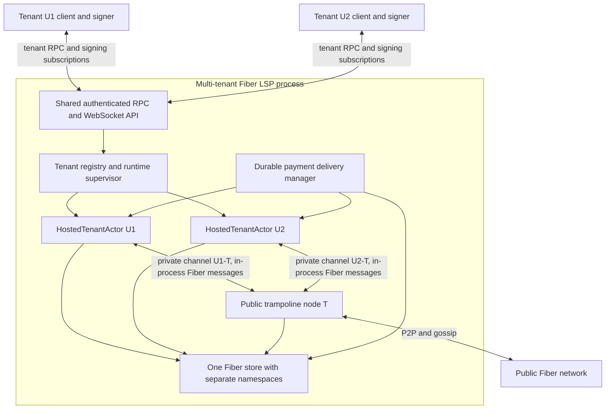
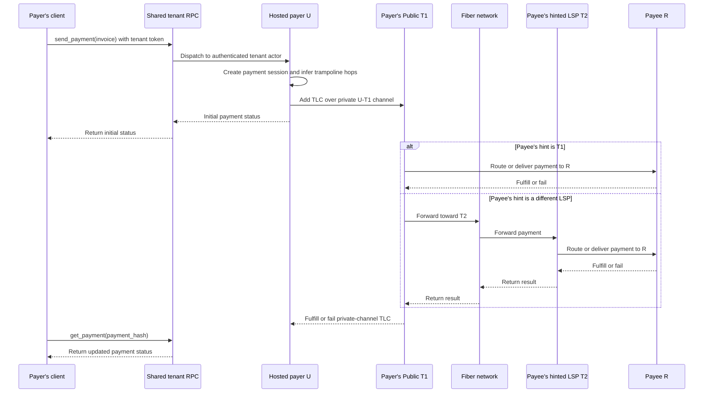
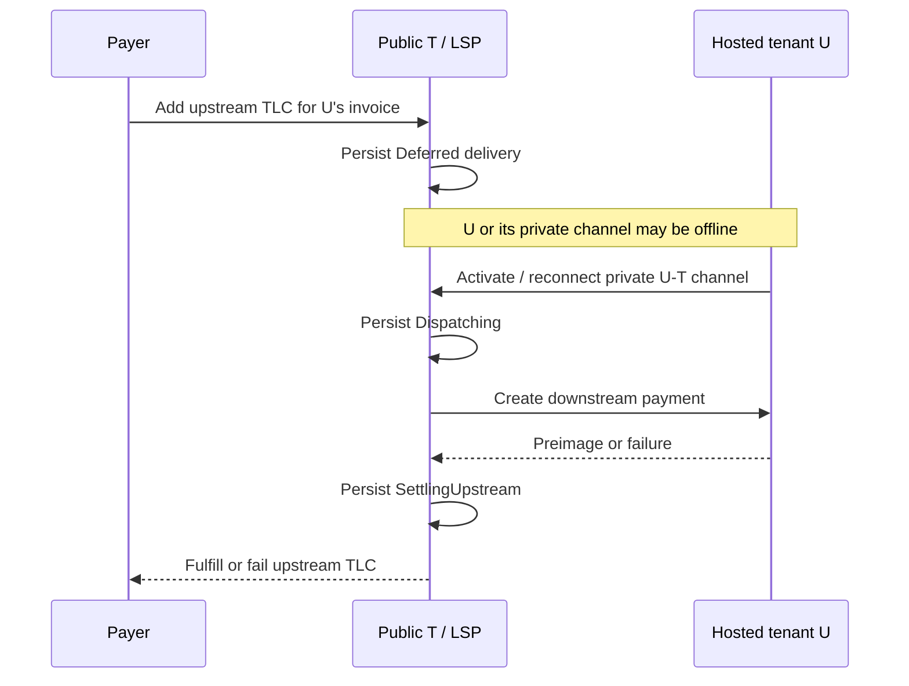

# Hosted LSP

Fiber's hosted Lightning Service Provider (LSP) runs one public trampoline node
alongside multiple isolated tenant runtimes. A tenant can use a private channel
to send payments through the public network and receive payments while its
client is temporarily offline. This page describes the implementation in this
repository, including the remote signer boundary and its current limitations.

## Architecture and ownership



Public T is the only gossip-routable node. Each tenant has a separate Fiber
protocol key for its invoice and private-channel state machines, but no public
P2P listener, gossip actor, or full public `NetworkActor`. Its
`HostedTenantActor` uses the shared `FiberActorCore` data plane. Existing Fiber
channel messages keep their protocol semantics; co-located U-T peers exchange
them through in-process actor routing rather than a Tentacle connection.

The LSP owns the tenant's Fiber protocol identity key. The client owns its
`RootSigner` identity key and the secret channel-signing material for externally
signed channels. These are **different keys**: hosting the protocol key does not
give the LSP authority to create a valid external channel signature. The
client's funding wallet is a separate key domain again. The LSP still controls
availability, constructs tenant invoices, and holds the upstream TLC during
buffered delivery; external signing alone does not make the service trustless.

The public node's data, LSP metadata, and tenant channel/payment/invoice data
share one Fiber database. `NodeNamespace::lsp_metadata()` and
`NodeNamespace::hosted_tenant(tenant_id)` separate their keyspaces. Tenant-local
runtime files, including the LSP-held protocol key, live under
`$BASE_DIR/lsp/tenants/<tenant-id>`. `TenantRegistry` persists identities and
channel bindings; `TenantSupervisor` tracks only active actors. The active
runtime count is bounded, and eviction is explicit and denied while relevant
payments, TLCs, channel operations, or deliveries are still live. A cold tenant
can be activated again without losing its stored state. A tenant can bind
multiple private channels, including channels for different assets.
The host keeps watchtower rows for admitted private channels even when their
tenant actors are evicted; new rows remain subject to per-tenant and global
watchtower quotas.

## Registering and accessing a tenant

A client creates a `RootSigner` key and signs a `TenantRegistryPayload` that
binds the trusted Public T identity, its compressed RootSigner public key, a
fresh 32-byte request ID, and a millisecond Unix timestamp. The signed bytes
use the canonical encoding in
[`fiber-types`](../crates/fiber-types/src/hosted_lsp.rs): protocol-domain bytes,
both compressed public keys, request ID, then big-endian `u64` timestamp. The
proof is valid for at most five minutes, with up to 30 seconds of future clock
skew. The request ID is consumed durably, so a lost response requires a **new**
proof rather than replaying the previous one.

An operator submits that proof to `lsp_register_tenant`. The server verifies
it, derives the tenant ID as
`hex(blake2b_hash_with_salt(compressed_root_signer_pubkey, TENANT_ID_DOMAIN))`,
and atomically records the tenant and consumed request ID. The client does not
choose its tenant ID. Registering again with a fresh proof refreshes access
without replacing the tenant identity or its channel bindings. RootSigner
rotation while retaining the same tenant ID is not implemented.

Registration returns a tenant-scoped Biscuit token and its expiration time;
the default lifetime is 30 days. The token carries tenant, node, permission,
and revocation-epoch facts. Tenant RPC identity comes from the authenticated
token, never from a client-supplied `tenant_id`. `lsp_revoke_tenant_tokens`
increments the stored epoch, invalidating previously issued tokens for new
authenticated requests. An already established subscription keeps the scope
checked at subscription time; revocation does **not** by itself close that
WebSocket stream. Operators should also disconnect affected sessions when
immediate stream termination matters.

The shared RPC endpoint exposes the following operator methods when LSP is
running:

| Purpose | Methods |
| --- | --- |
| Inspect | `lsp_get_status`, `lsp_list_tenants`, `lsp_get_payment_delivery` |
| Manage | `lsp_register_tenant`, `lsp_ensure_tenant`, `lsp_evict_tenant`, `lsp_revoke_tenant_tokens` |

With Biscuit authentication, inspection needs `read("lsp")` and management
needs `write("lsp")`. Tenant tokens cannot call these methods. They can call a
restricted set of ordinary Fiber RPC methods, including `new_invoice`,
`send_payment`, `get_invoice`, `get_payment`, `list_channels`, the external
channel-funding and signing methods, and tenant-scoped watchtower and
subscription methods. The authoritative allowlist is
[`TENANT_SCOPED_METHODS`](../crates/fiber-lib/src/rpc/tenant.rs); all other
methods, including the ordinary `open_channel`, are denied to tenant tokens.
`get_invoice` and `get_payment` also accept an optional `tenant_id` for
authorized queries: a tenant may only select itself, while an operator needs
both the ordinary read permission and `read("lsp")` to select a tenant.

## Private channels and remote signing

Each tenant establishes a private U-T channel with the ordinary channel
protocol, but the hosted side uses external signing. The client calls
`open_channel_with_external_funding`, provides signer-owned V2 public material,
signs the funding transaction, and submits it through
`submit_signed_funding_tx`. Additional channels have their own bindings and
signer material. The tenant cannot use `open_channel`: that method assumes the
node's local funding wallet and internal signer. Channel status reports each
binding's channel ID, asset type script (`null` for CKB), and online state.

The Node persists a typed channel signing request before pausing a state
transition. The client reads it via `get_channel_signing_status` or the
`channel_signing` WebSocket subscription, verifies it with `fiber-lsp-sdk`,
then calls `submit_channel_signature`. The Node verifies tenant/channel
ownership, request identity, and the response before continuing the channel
actor. A repeated identical response is idempotent; a conflicting one is
rejected. Watchtower signing has the corresponding
`get_watchtower_signing_status`, `watchtower_signing`, and
`submit_watchtower_signature` flow. Subscriptions replay current pending state
on connection, but are **not** a durable historical event log or an exactly-once
mailbox; clients must reconnect, resubscribe, and reconcile status queries.

External channel sessions use V2 public nonce pools and indexed commitment
points. The SDK durably stores secret nonces before advertising their public
counterparts and binds each nonce slot to its channel, commitment owner,
commitment number, purpose, and signing context. Cooperative close uses a
distinct closing purpose. A changed signing session must never reuse a secret
nonce, including across client restarts or signer-store rollback. The Node
stores public signer material and pending requests, not external channel
secrets, and must never silently fall back to its local signer. See the
[`fiber-lsp-sdk` guide](../crates/fiber-lsp-sdk/README.md) for opening,
verification, nonce storage, watchtower, and preimage-release policies. The
agent under `tests/fiber-lsp-sdk-agent` is a test/example integration, not a
production mobile wallet policy.

An external signer can be offline while a channel transition waits for its
signature. The pending request and continuation survive a tenant actor
restart. Ordinary TLC expiry safety still applies: a signer cannot extend an
in-flight TLC's on-chain window merely by delaying a signature. The Node's
signing-submission and maintenance paths enforce a deadline and can force
close a channel when signing cannot safely finish.

## Sending a payment

An authenticated tenant calls the normal `send_payment` RPC. It runs a payment
session in that tenant's namespace, potentially with the existing MPP sender.
For an invoice-only payment, the route builder uses its trampoline hint. A
hosted payer first reaches its **own** Public T, then the recipient's hinted
LSP if different. Explicit `trampoline_hops` override this inference. The
public node's ordinary payments and ordinary trampoline forwarding continue
to use the same payment data plane.

For an invoice with a trampoline hint, the hosted payer's workflow is:



The public Fiber network may contain multiple intermediate hops; `N` is not
one specific node. If the payee is hosted, its LSP may buffer the final
delivery as described below. For a non-hosted payee, the final hop follows
ordinary Fiber routing. The result propagates back along the selected path.

## Receiving and buffering a payment

The tenant calls the normal `new_invoice` RPC with its token. The Node signs
the invoice with the tenant protocol key, inserts Public T as its signed
`TrampolineRouteHint`, and registers the payment hash and a signed internal
`LspInvoiceHint` before replying. The latter binds the signed invoice digest,
Public T, payment hash, buffer duration, and invoice expiry; it is **not**
embedded in the invoice or trampoline onion. Payers treat this as an ordinary
trampoline invoice and need not know that the payee is hosted. Public T looks
up its internal registration when a corresponding upstream TLC arrives. An
unregistered payment follows ordinary trampoline forwarding rather than being
buffered.
Payer implementations must understand the invoice's `TrampolineRouteHint`
attribute; older invoice decoders that do not recognize it cannot pay such an
invoice.

Hosted `new_invoice` requires the client to provide either `payment_hash` or
`payment_preimage`; the LSP does not generate the settle secret. For a
non-custodial hold invoice, provide **only the hash** and keep the preimage on
the client. If the client instead supplies `payment_preimage`, the LSP receives
and stores it; external signing does not undo that disclosure. The client
should authorize preimage release against its independent channel/chain view
as described in the SDK guide. Hosted invoices currently reject
`allow_mpp: true` because incoming hosted MPP aggregation is not implemented.



The upstream TLC is the **payer-to-T** transfer being held. The downstream
payment is **T-to-U**. `Deferred` means that T has accepted but not removed
the upstream TLC while waiting for the tenant/channel or a transient retry.
An initially deferred delivery may select an online private channel for the
invoice's asset; after a dispatch attempt it retains the selected channel to
avoid re-executing an ambiguous payment on a different channel.

For an undispatched delivery, the deadline is the earliest of:

```text
accepted_at + registered_buffer_duration
invoice.expires_at
max_outgoing_tlc_expiry - tlc_expiry_delta - 30 seconds
```

The service uses a 24-hour default buffer duration, capped by the operator's
`max_buffer_duration_ms` (at most seven days). The current tenant `new_invoice`
RPC does **not** request a per-invoice duration. Neither default nor cap
guarantees a full-day wait: invoice and TLC expiries can end it sooner.
The buffer deadline governs `Deferred` and `Dispatching`, not an already
`InFlight` downstream payment; normal payment and TLC expiry rules govern the
latter.

The durable delivery lifecycle is:

```text
Deferred -> Dispatching -> InFlight -> SettlingUpstream -> Succeeded / Failed
    ^            |            |
    +------------+------------+  transient dispatch/payment failure
```

Permanent failures, invoice cancellation, or deadline expiry fail the
upstream TLC instead of retrying. Tenant `cancel_invoice` wakes an active
delivery so it can re-check the invoice and fail promptly. A transient route
or peer failure returns to `Deferred` until its deadline. The record exposes
`attempt_count`, `last_error`, and error code for inspection. On restart, the
LSP reconciles non-final records with the **exact** upstream channel and TLC,
the payment session, and the persisted settlement state before resuming.

The delivery key is `(incoming_channel_id, incoming_tlc_id)`, not merely the
payment hash. A separate hash index finds the invoice/delivery. Hosted
downstream payment sessions use the real payment hash plus an optional
`UpstreamTlcKey` so another same-hash payment cannot donate its outcome to
this delivery. Ordinary payment sessions retain their hash-only identity.
Only one active incoming hosted execution for a payment hash is accepted; a
second incoming part is not aggregated. One accepted upstream TLC can,
however, be split into multiple **downstream** parts using existing MPP sender
logic. These are different directions of MPP support.

## Configuration and operating boundaries

The `lsp` Cargo feature is enabled by default. A binary built without it
rejects an `lsp` configuration section. To run the service, enable `fiber`,
`ckb`, `rpc`, and `lsp` in `services`, and configure the RPC Biscuit public key
and private-key path. Do not expose the operator RPC or its issuing key to
untrusted clients. The full sample is in
[`config/mainnet/config.yml`](../config/mainnet/config.yml); the relevant
limits are:

```yaml
services:
  - fiber # Run Public T's Fiber node and payment/channel actors.
  - ckb   # Connect to CKB for funding, chain events, and settlement.
  - rpc   # Expose the authenticated operator and tenant RPC endpoints.
  - lsp   # Start the hosted tenant and payment-delivery service.

lsp:
  token_ttl_secs: 2592000 # Lifetime of newly issued tenant tokens: 30 days.
  max_active_tenants: 64 # Maximum resident tenant actors at one time.
  max_buffer_duration_ms: 604800000 # Operator cap on invoice buffering: 7 days.
  max_pending_deliveries: 1024 # Maximum non-final deliveries across all tenants.
  max_pending_deliveries_per_tenant: 64 # Maximum non-final deliveries for one tenant.
  max_watch_channels_per_tenant: 64 # Maximum watchtower channel rows for one tenant/node.
  max_watch_channels: 4096 # Maximum watchtower channel rows across all nodes.
  max_watch_preimages_per_tenant: 256 # Maximum watched preimages for one tenant/node.
  max_watch_preimages: 16384 # Maximum watched preimages across all nodes.
```

These bounds protect runtime, pending-delivery, and watchtower capacity, but
they do not provide complete per-tenant CPU, memory, bandwidth, or fee
isolation. Admission to a private channel does not prove that the remote
signer is connected and synchronized. There is no production push service,
durable signer event mailbox, or fenced long-lived signer session in this
implementation. A channel that is online may still stall on an unavailable
signer; TLC safety deadlines and channel force-close behavior remain the last
resort. Treat signer state-root verification, mobile preimage policy, and
crash/race testing as deployment-specific security work rather than assuming
that a test agent or an online channel establishes readiness.

Relevant implementation and tests:

- [LSP runtime and service](../crates/fiber-lib/src/lsp/),
  [delivery state](../crates/fiber-lib/src/lsp/delivery.rs), and
  [configuration](../crates/fiber-lib/src/lsp_config.rs)
- [LSP RPC](../crates/fiber-lib/src/rpc/lsp.rs),
  [tenant RPC allowlist](../crates/fiber-lib/src/rpc/tenant.rs), and
  [invoice RPC](../crates/fiber-lib/src/rpc/invoice.rs)
- [Shared hosted types](../crates/fiber-types/src/hosted_lsp.rs),
  [SDK guide](../crates/fiber-lsp-sdk/README.md), and
  [LSP integration tests](../crates/fiber-lib/src/lsp/tests/)
